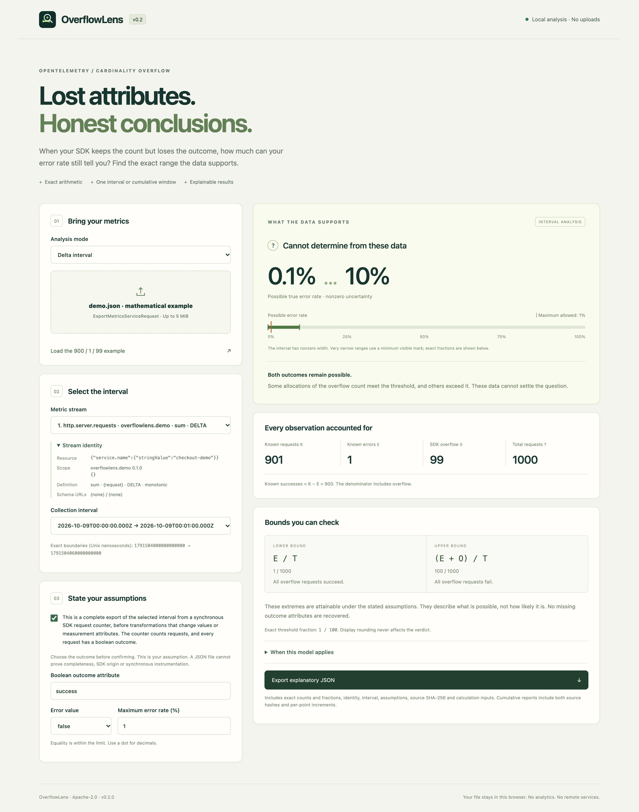
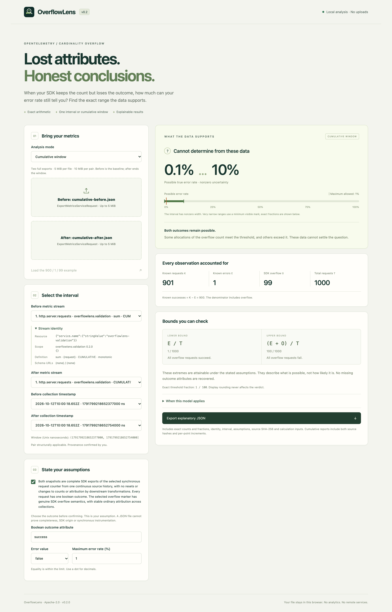

<p align="center"></p>

# OverflowLens

[](LICENSE)
[](https://github.com/0then0/overflowlens/actions/workflows/ci.yml)
[](docs/validation.md)

OverflowLens calculates **exact error-rate bounds after OpenTelemetry SDK cardinality overflow**. Import a saved request counter, choose a delta interval or a window between two cumulative snapshots, and compare the possible error rates with your limit.

Files stay on your computer. The application runs in your browser, with no accounts, uploads, analytics, remote fonts or external application requests. The badges above are external README images; the application does not load them.

## Why bounds?

When an SDK reaches its cardinality limit, it can preserve request counts while replacing measurement attributes with `otel.metric.overflow=true`. The request outcome is then unknown. Filtering only by `success=false` excludes those unknown outcomes.

```text
Known successes                 900
Known errors                      1
SDK overflow                     99
Total                         1,000

Possible true error rate       0.1% … 10%
Maximum allowed error rate       1%
Conclusion: Cannot determine from these data
```

All 99 overflow requests could have succeeded, failed, or had any mixture of outcomes. OverflowLens reports attainable bounds without guessing their outcomes or assigning probabilities.

## Screenshots

**Delta interval.** The built-in example has 900 known successes, one known error and 99 overflow requests. Its possible error rate is 0.1%…10%, so a 1% limit cannot be decided from these data. The result includes exact counts, attainable bounds and an explanatory JSON export.



**Cumulative window.** Two snapshots from the [Go SDK validation workload](docs/validation.md) define the selected window. The application checks that the pair is structurally applicable and calculates bounds from per-point increments, excluding baseline observations.



## Run a published build

Download a static archive from [GitHub Releases](https://github.com/0then0/overflowlens/releases), extract it, and change into the extracted `overflowlens-<version>` directory. Check that release's notes for its supported modes; cumulative windows require v0.2 or later.

Start a local HTTP server, for example:

```sh
python3 -m http.server 8080 --bind 127.0.0.1
```

Open http://127.0.0.1:8080. The application files are in the extracted directory, without a nested `dist/`. Any static HTTP server works. Node.js and Go are not required to use the compiled application. `SHA256SUMS.txt` identifies the archive bytes.

Use HTTPS for remote hosting. Opening `index.html` through `file://` is unsupported.

## Analyze your data

1. Choose **Delta interval** or **Cumulative window**. Delta accepts one OTLP JSON file or the built-in example. Cumulative requires separate **Before** and **After** exports.
2. Select one Resource/scope/metric stream and its collection boundaries. For cumulative mode, select matching streams and inspect the pair applicability status and exact `(before, after]` window.
3. Enter the boolean measurement outcome key, such as `success`, and select which value means error.
4. Confirm the provenance contract after checking that it applies to your data.
5. Enter the maximum allowed error percentage. Equality meets the limit.
6. Export the explanatory JSON to retain the selected inputs, assumptions, exact counts, fractions and conclusion.

Changing either file, stream, boundary, outcome, error value or mode clears the previous verdict and provenance confirmation. Changing only the threshold uses the same validated counts. The outcome key can be entered manually, including for an overflow-only interval.

## Interpret the result

- **Within limit:** every compatible error rate meets your limit.
- **Exceeds limit:** every compatible error rate exceeds your limit.
- **Cannot determine:** compatible rates exist on both sides of the limit.
- **No observations:** the selected interval or window totals zero, so no error rate is defined.
- **Invalid input / Unsupported input:** the data or assumptions do not support a calculation. The diagnostic identifies the reason.

A refusal is different from mathematical uncertainty. Malformed related data blocks a verdict rather than silently reducing counts; an independent unsupported metric does not invalidate a supported selection.

## Supported inputs

Use uncompressed UTF-8 OTLP JSON `ExportMetricsServiceRequest` files, with lowerCamelCase field names and numeric enum values. Files are limited to **5 MiB each**, and a cumulative pair to **10 MiB combined**.

Both modes analyze a synchronous request counter represented as a monotonic integer `Sum`. Every ordinary point must retain the selected boolean measurement outcome. SDK overflow must contain exactly one measurement attribute: `otel.metric.overflow=true`.

- **Delta:** one complete collection interval, with common start and end timestamps.
- **Cumulative:** two complete exports of the same stream, one collection timestamp per selected stream per file, ordered boundaries, identical measurement identity sets, known unchanged starts for corresponding series, and no decreasing counts. Different series may have different start times.

Completeness, synchrony, one boolean outcome per request, genuine SDK overflow semantics and unchanged downstream counts/attribution require user confirmation. Cumulative mode also requires one continuous source history with stable ordinary attribution. Metadata and source hashes do not prove these conditions.

New or disappearing series, unknown starts and reset-spanning windows are unsupported. Missing points are never zero-filled or intersected away. The application does not aggregate processes, recover lost outcomes, ingest live metrics, provide a general temporality converter or assess a full SLO. Read the [input contract](docs/input-contract.md) for the complete rules.

## Exact arithmetic and reports

For ordinary requests `K`, known errors `E`, overflow requests `O`, and total `T = K + O`:

```text
lower = E / T
upper = (E + O) / T
upper <= limit  → WITHIN_LIMIT
lower > limit   → EXCEEDS_LIMIT
otherwise       → INDETERMINATE
T = 0           → NO_DATA
```

Cumulative mode first subtracts each matched point's before count from its after count. K, E and O are sums of those increments; baseline observations are excluded. Percentages and snapshot bounds are never subtracted.

Counts, fractions and comparisons use `BigInt`. Rounding affects display only. See [mathematics](docs/mathematics.md) for the proof and endpoint witnesses.

Delta reports use schema v1. Cumulative reports use schema v2, preserving both original-file SHA-256 hashes, selected identities, exact boundaries, settings, assumptions, applicability checks, matched counts/increments, fractions and witnesses. Refusal reports retain diagnostics and selected inputs without inventing rates. A hash identifies bytes, not authenticity.

## Build from source

Requires Node.js 24.21+ and npm. Dependencies are pinned in `package-lock.json`.

```sh
npm ci
npm run dev
```

Open the localhost URL printed by Vite. To build and preview the static application:

```sh
npm run build
npm run preview
```

The source build writes application files into `dist/`. Serve that directory locally over HTTP or remotely over HTTPS. Relative asset URLs support hosting under a subdirectory.

## Documentation and development

- [Input contract](docs/input-contract.md): representations, stream identity, diagnostics and report fields.
- [Mathematics](docs/mathematics.md): attainable bounds and exact decisions.
- [SDK validation](docs/validation.md): the pinned Go SDK workload, fixtures and reproduction commands.
- [Design and references](docs/research.md): OpenTelemetry semantics and implementation choices.
- [Contributing](CONTRIBUTING.md): source layout, checks, formatting and release packaging.
- [v0.2 release notes](docs/releases/v0.2.0.md): features and compatibility.

Licensed under [Apache-2.0](LICENSE). Bundled libraries retain their licenses in [third-party notices](public/third-party-notices.txt).
